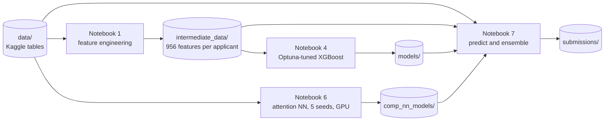

# Credit Risk Modeling: Home Credit Default Risk

Predicts the probability that a loan applicant will have payment difficulties, using the [Home Credit Default Risk](https://www.kaggle.com/c/home-credit-default-risk) competition data: an application table plus six tables of each applicant's credit history (credit bureau, previous applications, POS/cash loans, credit cards and instalment payments).

The best submission blends two very different models: a tuned XGBoost on 956 hand-engineered features, and an attention network that reads the raw history tables. The blend scores **0.79326 ROC AUC on the private leaderboard** (0.79570 public).


## Results

### Kaggle leaderboard

| Submission (`submissions/`) | Model | Holdout AUC | Public LB | Private LB |
|---|---|---:|---:|---:|
| `nn_xgb_ensemble_submission.csv` | Rank average: 0.4 × attention NN + 0.6 × XGBoost | 0.7966 | **0.79570** | **0.79326** |
| `xgb_submission.csv` | Optuna-tuned XGBoost (notebook 4) | 0.7938 | 0.79321 | 0.79079 |
| `comp_nn_submission.csv` | Attention NN, mean of 5 seeds (notebook 6) | 0.7905 | 0.78702 | 0.78513 |

Notebook 7 writes all three files from the saved models, together with a `.json` of holdout metrics for each. Blending adds 0.0025 private AUC over XGBoost alone. The two models' test predictions have a Spearman correlation of only 0.92, so each carries information the other lacks.

### Model benchmarks

Holdout is the 20% validation split described under [Validation and splits](#validation-and-splits).

| Model | Notebook | Inputs | Validation | ROC AUC |
|---|---|---|---|---:|
| XGBoost, default parameters | 2 | Application table only | Holdout | 0.7493 |
| Logistic regression, elastic net (grid search) | 3 | Engineered table | Holdout | 0.7784 |
| MLP, one hidden layer | 4 | Engineered table | Holdout | 0.7787 |
| Attention NN, single seed (mean ± std of 5 seeds) | 6 | Raw tables | Holdout | 0.7860 ± 0.0014 |
| LightGBM, fixed parameters | 1 | Engineered table | 5-fold CV | 0.7883 ± 0.0045 |
| Attention NN, mean of 5 seeds | 6 | Raw tables | Holdout | 0.7905 |
| XGBoost, Optuna-tuned | 4 | Engineered table | Holdout | 0.7938 |
| Attention NN + XGBoost, rank average | 7 | Both models' predictions | Holdout | 0.7966 |

- The two neural networks are different models. Notebook 4's MLP is a small baseline on the engineered table; notebook 6's network is a transformer that reads the raw history tables (see [Models](#models)).
- Notebooks 1–5 are saved without outputs, so their numbers come from earlier runs. Notebook 7 reloads the saved tuned XGBoost and gets the same 0.7938. Notebooks 6 and 7 keep their outputs.

## Project specification

| | |
|---|---|
| Task | Binary classification: probability that `TARGET = 1` (the client had payment difficulties) |
| Prediction unit | One applicant (`SK_ID_CURR`) |
| Metric | ROC AUC, the competition metric |
| Labeled data | 307,511 applicants: 91.9% `TARGET = 0`, 8.1% `TARGET = 1` |
| Test data | 48,744 applicants, scored by Kaggle on a public and a private leaderboard |
| Submission | CSV with columns `SK_ID_CURR, TARGET`, one row per test applicant |

### Data

| Table | Rows | One row per | Linked to the applicant by |
|---|---:|---|---|
| `application_train` / `application_test` | 307,511 / 48,744 | applicant | `SK_ID_CURR` |
| `bureau` | 1,716,428 | credit reported by another institution | `SK_ID_CURR` |
| `bureau_balance` | 27,299,925 | month of a bureau credit | `SK_ID_BUREAU` → `bureau` |
| `previous_application` | 1,670,214 | earlier Home Credit application | `SK_ID_CURR` |
| `POS_CASH_balance` | 10,001,358 | month of an earlier POS or cash loan | `SK_ID_CURR` |
| `credit_card_balance` | 3,840,312 | month of an earlier credit card | `SK_ID_CURR` |
| `installments_payments` | 13,605,401 | payment toward an earlier loan's instalment | `SK_ID_CURR` |

`DAYS_EMPLOYED = 365243` is a placeholder for "not employed" (mostly pensioners), so every notebook replaces it with a missing value.

### Pipeline



Notebooks 2, 3 and 5 are side branches (baselines and explainability) and do not feed the submissions.

## Validation and splits

- **One holdout for every notebook.** All holdout AUCs use `train_test_split(test_size=0.2, stratify=TARGET, random_state=42)` on `application_train`: 246,008 training and 61,503 holdout applicants. Notebooks 2, 3, 4, 6 and 7 make the same call on the same row order. Every holdout AUC is therefore measured on the same applicants, and the models can be blended on them.
- **Preprocessing is fit on training applicants only.** This covers imputers, scalers and encoders. In notebook 6 it also covers each history table's preprocessing, which is fit on the rows of training applicants.
- **Tuning stays inside the 80%.** Optuna (notebook 4) uses 3-fold stratified CV, and the logistic regression grid search (notebook 3) uses 5-fold CV.
- **The holdout also does some model selection.** Both neural networks stop at the epoch with the best holdout AUC, and the blend weight is chosen on the holdout. Their holdout AUCs are therefore slightly optimistic. The Kaggle scores have no such bias and rank the three submissions in the same order.
- **Feature-lift test.** Notebook 1 scores the engineered table with LightGBM under 5-fold stratified CV on all labeled applicants (`train_lgbm` in `helpers/modeling_helpers.py`). Each fold stops early on its own validation part, so this estimate is slightly optimistic too.
- **No refit on all labels.** The submitted models were trained on the 80% only. Refitting on 100% would probably gain a little AUC, but the blend weight could no longer be checked on a clean holdout.
- **Class imbalance.** The logistic regression uses `class_weight="balanced"`, and notebook 4's MLP up-weights positives in its loss. The tree models and the attention NN are trained unweighted. ROC AUC depends only on ranking, so predictions are not calibrated. The ensemble file holds rank scores in (0, 1], not probabilities.

## Feature engineering

### Engineered table (notebook 1)

`helpers/preprocessing_helpers.py` aggregates each history table to one row per applicant and left-joins the results onto the application table. That gives 956 features: 120 raw application columns, 21 application ratios and about 815 history aggregates. Notebook 1 saves them to `intermediate_data/`, and notebooks 3, 4, 5 and 7 read them from there.

| Source | Features |
|---|---|
| Application | credit/income, annuity/income, annuity/credit, employment length/age, income per family member and its ratio to credit; mean, std and product of `EXT_SOURCE_1–3`; credit and annuity divided by each `EXT_SOURCE`; age and 10-year age band; number of documents provided; income and credit per day employed; income per year of age |
| Bureau | share of each credit's months in DPD buckets 1–4 (mild) and 5 (severe), from `bureau_balance`; max/sum/mean/std of every numeric column; number of credits by type and by status (active, closed, sold, bad debt); total debt / total credit |
| Previous applications | application/credit, annuity/credit, down payment / goods price, down payment / credit; numeric aggregates over all applications, split by `FLAG_LAST_APPL_PER_CONTRACT`, and separately for approved and refused applications; counts of each category value |
| POS/cash | max/mean/sum/std of `SK_DPD` and `SK_DPD_DEF` per loan over the last 12, 24 and 36 months, then aggregated per applicant; numeric aggregates; counts by contract status |
| Credit card | balance / credit limit, payment / total receivable; for the last 12 and 24 months, how often the payment covered the principal, the receivable and the total receivable; numeric aggregates; counts by contract status |
| Instalments | paid / due, fully-paid flag, late flag, payment day / due day; counts of late, fully paid, and fully-paid-and-on-time payments over the last 12, 24 and 36 months; numeric aggregates |

### Attention NN inputs (notebook 6)

Notebook 6 does not use the engineered table. It keeps the history tables at row level, adds a few per-row signals, and lets the network learn how to summarize each table.

| Input | Kept per applicant | Added per row |
|---|---|---|
| Application | 104 numeric and 16 categorical columns | — |
| `installments_payments` | 100 most recent payments | days late, amount short, paid/due, late flag |
| `bureau` | all credits (up to 116) | debt/credit, overdue flag, and a summary of the credit's `bureau_balance` history: months on record, share of months past due, worst DPD bucket, past-due months in the last year, latest status |
| `bureau_balance` | 100 most recent months across all bureau credits | — |
| `credit_card_balance` | 100 most recent months | balance/limit, payment / minimum instalment, past-due flag |
| `POS_CASH_balance` | 100 most recent months | share of instalments left, past-due flag |
| `previous_application` | 32 most recent applications | credit/application, annuity/credit; `365243` date codes become missing |

- Numeric columns are quantile-transformed to a normal distribution, fit on training applicants. Missing application values stay missing, because the model has a learned "missing" token; history values are median-imputed first.
- The transformer is `TieBreakQuantileTransformer`, which adds tiny noise before fitting the quantiles. A plain `QuantileTransformer` sends every value tied at a column's min or max to ±5.2. That would push all 0/1 flags and mostly-zero counts to ±5.2.
- Categorical columns are ordinal-encoded, with one extra index for categories not seen in training.
- Each table is zero-padded to its row cap, with a mask so the model ignores the padding.

## Models

**Baselines (notebooks 2–3).** Notebook 2 fits XGBoost with default parameters, and a logistic regression, on the application table alone. Notebook 3 fits logistic regression on the engineered table, with mean imputation, standardization, one-hot categoricals and `class_weight="balanced"`. It starts with a Newton–Cholesky L2 fit, then runs an elastic-net grid search with saga over `l1_ratio ∈ {0, 0.1, 0.5, 0.9, 1}` and `C ∈ {1, 0.1, 0.01}`.

**Gradient boosting (notebook 4).** XGBoost (one-hot categoricals, native handling of missing values) and LightGBM (native categoricals) are each tuned with 50 Optuna trials on 3-fold CV AUC. XGBoost is then refit on the training applicants with its best parameters and saved to `models/`: 2,951 trees, depth 5, learning rate 0.0148, subsample 0.83, column sample 0.94, min child weight 2.14, gamma 0.13, L2 4.36, L1 1.5e-4. The best LightGBM parameters are saved too, but no final LightGBM model is trained.

**MLP (notebook 4).** A baseline network on the engineered table. Preprocessing drops all-empty columns, median-imputes with missing-value indicators, quantile-transforms and one-hot encodes categoricals. The network has one hidden layer of 256 units with batch norm, ReLU and dropout 0.4. It trains with binary cross-entropy (positives up-weighted by the class ratio), AdamW (lr 1e-3, weight decay 1e-4) and batch size 128, stopping early on holdout AUC with patience 8. The model is `NNModel` in `helpers/modeling_helpers.py`.

**Attention NN (notebook 6).** A small transformer (295k parameters) that turns each input into a 64-dimensional token:

- **Application numeric column:** value × a learned vector + a learned bias, or a learned "missing" vector when the value is NaN.
- **Application categorical column:** an embedding.
- **History table:** each row passes through a two-layer MLP (numeric values plus category embeddings → 64 → 64). A masked mean over the applicant's rows then gives one token for the table.
- **CLS:** a learned token whose output feeds the prediction head.

These 127 tokens (1 CLS, 104 numeric, 16 categorical, 6 tables) pass through 3 pre-norm transformer encoder layers (4 heads, feed-forward width 192, dropout 0.1). The CLS output then goes through a 64 → 8 → 1 head. Training uses unweighted binary cross-entropy, AdamW (lr 3e-4, weight decay 1e-5) and batches of 1,024 applicants. It stops after 5 epochs without a holdout AUC improvement; the best epochs were 11–14. Five seeds (0–4) are trained, and the test predictions average all five.

**Ensemble (notebook 7).** The blend is `w · rank(NN) + (1 − w) · rank(XGBoost)`. It averages ranks rather than probabilities because the two models' probabilities are on different scales and AUC depends only on order. `w` is chosen on a 0.05 grid on the holdout. The best is 0.40, with holdout AUC 0.7966; an even 50/50 split gives 0.7964.

**Explainability (notebook 5).** Shows feature importance (gain, total gain, weight, cover) and a SHAP summary plot for the tuned XGBoost, computed on the 61,503 holdout applicants. 878 of the 1,090 one-hot columns are used in at least one split. The averaged external score `app__EXT_SOURCE_MEAN` dominates both views: its total gain is about 10 times that of the next feature, annuity/credit (`app__CREDIT_TERM`).

## Repository layout

| Path | Contents |
|---|---|
| [`1. feature_engineering_test_lift.ipynb`](1.%20feature_engineering_test_lift.ipynb) | builds the engineered table; LightGBM lift test |
| [`2. baseline.ipynb`](2.%20baseline.ipynb) | application-only baselines |
| [`3. logistic.ipynb`](3.%20logistic.ipynb) | logistic regression on the engineered table |
| [`4. model_benchmarks_tree_nn.ipynb`](4.%20model_benchmarks_tree_nn.ipynb) | Optuna LightGBM and XGBoost, final XGBoost, MLP |
| [`5. Explainability.ipynb`](5.%20Explainability.ipynb) | XGBoost importance and SHAP |
| [`6. attention_nn_multitable.ipynb`](6.%20attention_nn_multitable.ipynb) | attention NN on the raw tables, 5 seeds (trained on a RunPod GPU) |
| [`7. predict_and_ensemble.ipynb`](7.%20predict_and_ensemble.ipynb) | reloads the saved models and writes the three submissions |
| [`helpers/preprocessing_helpers.py`](helpers/preprocessing_helpers.py) | feature engineering for notebook 1 |
| [`helpers/modeling_helpers.py`](helpers/modeling_helpers.py) | `train_lgbm` (CV lift test), XGBoost pipeline, MLP |
| [`scripts/download_data.sh`](scripts/download_data.sh) | downloads and unzips the Kaggle data into `data/` |
| `submissions/*.json` | holdout metrics for each submission |
| `models/*_best_params.json` | tuned XGBoost and LightGBM hyperparameters from Optuna |

Generated and gitignored: `data/`, `intermediate_data/`, the model files in `models/` and `comp_nn_models/`, and `submissions/*.csv`.

## Reproduce

### Environment

- **Packages:** `requirements.txt` (versions are not pinned). The local environment runs Python 3.13 with numpy 2.4, pandas 3.0, scikit-learn 1.8, PyTorch 2.12 (CUDA 13.0), xgboost 3.2, lightgbm 4.6, optuna 4.9 and shap 0.52. Notebook 6 was trained on a RunPod GPU pod with Python 3.12, pandas 3.1 and scikit-learn 1.9.
- **Memory:** notebooks 6 and 7 hold every history table in RAM as padded float32 tensors, about 12 GB in total. Notebook 7 ran on a machine with 30 GB of RAM.
- **GPU:** both notebooks call `.to('cuda')`, so they need an NVIDIA GPU. The network is small enough for an 8 GB laptop GPU; notebook 7 ran on an RTX 3080 Laptop.
- **Training time:** on RunPod, each seed trained for 16–19 epochs at about 17 s per epoch, roughly 30 minutes for all five seeds.

### 1. Set up Kaggle API access

Downloading the data requires the Kaggle CLI (installed via `requirements.txt`) and a Kaggle API token:

1. Log in to Kaggle and accept the [Home Credit Default Risk competition rules](https://www.kaggle.com/c/home-credit-default-risk/rules) (the download fails with a 403 otherwise).
2. Go to [kaggle.com/settings](https://www.kaggle.com/settings) and create an API token.
3. Create a `.env` file in the project root with the token (it is gitignored — never commit it):

```bash
export KAGGLE_API_TOKEN=<your-kaggle-api-token>
```

### 2. Install and download

```bash
pip install -r requirements.txt
source .env
bash scripts/download_data.sh
jupyter lab
```

### 3. Run the notebooks

Run them from the repository root, in this order:

| Notebook | Reads | Writes |
|---|---|---|
| 1 | `data/` | `intermediate_data/train_dataset.csv`, `intermediate_data/test_dataset.csv` |
| 2, 3 (optional) | `data/`, `intermediate_data/` | — |
| 4 | `intermediate_data/` | `models/xgb_final_pipeline_w_50_optuna.joblib`, `models/*_best_params.json` |
| 5 (optional) | `intermediate_data/`, `models/` | — |
| 6 (GPU) | `data/` | `best_seed_{0..4}.pt` checkpoints |
| 7 (GPU) | `data/`, `intermediate_data/`, `models/`, `comp_nn_models/` | `submissions/*.csv`, `submissions/*.json` |

Notebook 6 still saves its checkpoints to `/workspace/`, the RunPod working directory. Move them into `comp_nn_models/`, where notebook 7 loads them.

### Reproducibility notes

- **Re-running notebook 4 changes the models.** Neither Optuna study is seeded, and notebook 4's MLP does not seed its weight initialization. A re-run gives a slightly different tuned XGBoost and MLP. The submissions come from the saved model, which is not in the repo. `models/xgb_best_params.json` is, so the final XGBoost can be refit without re-running Optuna.
- **NN checkpoints are reproducible to within about 0.0001 AUC.** Re-scored locally on a different GPU and library versions, they match the holdout AUCs recorded on RunPod to within about 0.0001 (notebook 7 prints both).


## License

Public domain ([Unlicense](LICENSE)).
